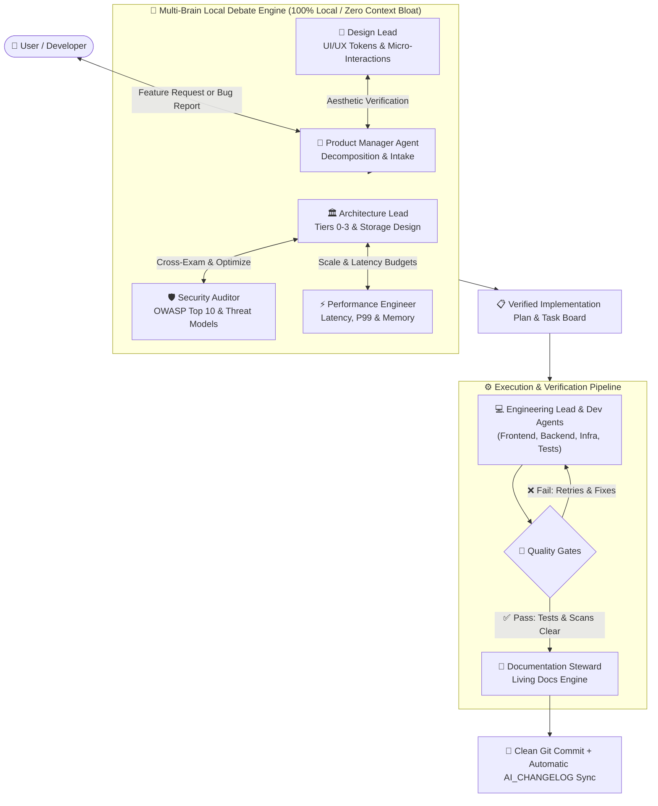
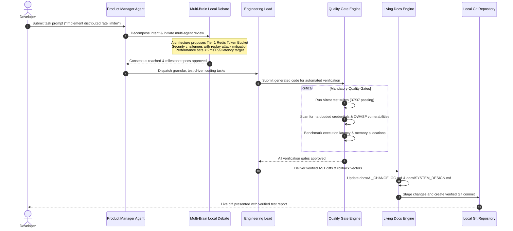
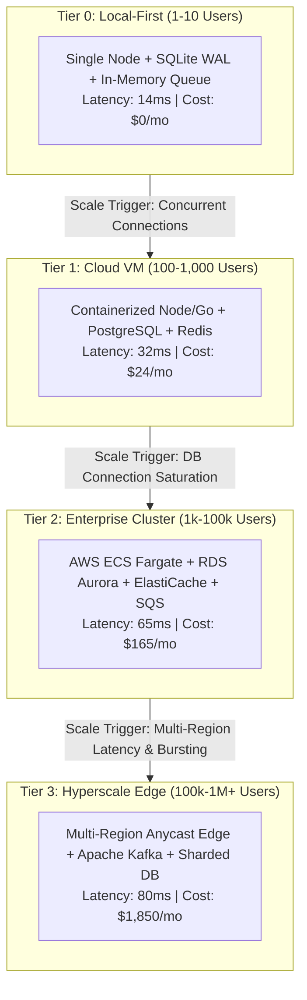

# ⚡ Forge: Enterprise AI Desktop IDE with Studio Brain

> **Forge** is a local-first, enterprise-grade AI Desktop IDE powered by **Studio Brain**—a hierarchical multi-agent orchestration architecture (*Product Manager $\rightarrow$ Team Leads $\rightarrow$ Specialized Sub-Agents*) featuring multi-brain local debate, pluggable skill registries, dual-process desktop sandboxing, and living documentation synchronization.

[]()
[]()
[]()
[]()
[]()

---

## 🏛️ System Architecture Diagrams

### 1. Studio Brain: Hierarchical Multi-Agent Orchestration & Local Debate Flow

Studio Brain coordinates specialized AI personas using a strict hierarchical chain of command. Sub-brains engage in localized multi-brain debate to eliminate hallucination, enforce clean code standards, and prevent context bloat:



---

### 2. Dual-Process Desktop Architecture & Security Sandboxing

Forge enforces zero-trust process isolation between the Node.js operating system layer and the Monaco-powered UI renderer via strictly typed schema IPC bridges:

```mermaid
flowchart LR
    subgraph Main_Process ["🖥️ Electron Main Process (Node.js Environment)"]
        direction TB
        MainCore["Main Lifecycle & Window Manager"]
        FSBridge["Path-Safe Filesystem Controller\n(Directory Traversal Guards)"]
        PTYRunner["Managed PTY Terminal & Child Process Runner"]
        LocalModelDaemon["Local Model Discovery\n(Ollama / llama.cpp Streaming API)"]
        Keychain["OS DPAPI / Keychain SafeStorage\n(Encrypted BYOK API Keys)"]
        REAMCP["REA Reverse Engineering Bridge\n(Binary & UI Inspection MCP)"]
    end

    subgraph IPC_Bridge ["🔐 Context Isolation Bridge (contextIsolation: true)"]
        direction TB
        TypedIPC["window.forgeAPI\n(Strictly Schema-Validated Typed IPC)"]
    end

    subgraph Renderer_Process ["🎨 Chromium Renderer Process (React 18 + Vite)"]
        direction TB
        UIContainer["App Shell & Navigation"]
        Monaco["Monaco Code Editor & Diff Viewer"]
        TerminalUI["xterm.js Terminal Emulator"]
        StudioView["Studio Brain Workspace & Task Board"]
        LivePreview["Sandboxed Localhost Preview Frame"]
        AIStream["Real-time Streaming Token Renderer"]
    end

    Main_Process <--> IPC_Bridge
    IPC_Bridge <--> Renderer_Process
```



---

### 3. Studio Brain Request-To-Commit Lifecycle

This sequence diagram illustrates how a developer prompt transitions through intake, consensus debate, lean-code generation, quality gates, and automated documentation sync:



---

### 4. Scalability Architecture Roadmap (Tiers 0–3)

Forge includes living system design specifications detailing scalability targets from local single-node development to hyperscale multi-region deployment:



---

## 🌟 Key Capabilities

1. **Studio Brain (Hierarchical Multi-Agent Orchestrator)**:
   - **Product Manager (PM)**: Single point of contact, intake, decomposition, milestone tracking, and final acceptance.
   - **Architecture Lead**: Systems Architect, Storage Designer, Performance Engineer, Cost Analyst (Tiers 0–3 architecture).
   - **Engineering Lead**: Frontend Dev, Backend Dev, DB/Infra Engineer, Test Engineer (Enforces Lean-Code policy).
   - **Design & Experience Lead**: UI Designer, Motion Dev, Design Researcher (`impeccable`, `taste-skill`, `react-bits`, `gsap-skills`).
   - **Quality, Security & Growth Lead**: Security Auditor, E2E Tester, SEO/GEO Specialist, Regression Reviewer, Documentation Steward.
2. **100% Local Multi-Brain Debate**:
   - Sub-brains debate locally (*Architecture proposes $\iff$ Security challenges $\iff$ Performance optimizes*) to produce verified, production-ready code on local models (Ollama, llama.cpp) without context bloat.
3. **Pluggable BYOK Cloud Support**:
   - 100% local-first default with zero subscriptions. Users can optionally configure their own API keys (Claude 3.5 Sonnet, GPT-4o, Gemini 2.5 Flash, Groq, OpenRouter) via encrypted OS DPAPI storage.
4. **Mandatory Quality Gates**:
   - Pre-push secret scanning, OWASP Top 10 validation, unit tests, latency benchmarks, and Lean-Code audits.
5. **Living Documentation Engine**:
   - [`docs/AI_CHANGELOG.md`](docs/AI_CHANGELOG.md) updated automatically from real Git diffs with line ranges, before/after excerpts, and rollback commands.
   - [`docs/PLAN.md`](docs/PLAN.md), [`docs/DESIGN.md`](docs/DESIGN.md), and [`docs/SYSTEM_DESIGN.md`](docs/SYSTEM_DESIGN.md) kept permanently in sync.

---

## 🚀 Quickstart & Local Installation

Clone and run Forge locally in under 2 minutes:

```bash
# 1. Clone the repository
git clone https://github.com/Subhash6102003/forge.git
cd forge

# 2. Install dependencies
npm install

# 3. Start development server (Vite + Electron)
npm run electron:dev
```

To run purely in the browser for web UI development:
```bash
npm run dev
```

---

## 🧪 Testing & Verification

Forge comes with a comprehensive two-tier test suite:

```bash
# Run Vitest unit & integration tests (37 tests)
npm test

# Run Cloudflare security-audit harness tests (65 tests)
npm run test:skills

# Run all test suites
npm run test:all

# Production bundle build (Vite + Electron)
npm run build:all
```

---

## 📂 Project Structure

```text
forge/
├── electron/              # Hardened Electron shell (PTY terminal, Git IPC, safeStorage)
│   ├── main.ts            # Window lifecycle, CSP headers, IPC routing
│   ├── preload.ts         # Strictly typed contextBridge exposing window.forgeAPI
│   └── voiceDictation.ps1 # Voice-to-text dictation integration
├── src/
│   ├── components/
│   │   ├── layout/        # ActivityBar, SidePanel, Monaco EditorArea, PreviewPanel, BottomPanel
│   │   ├── ui/            # Unified FileIcon, Button, Tree, Modal, Toast, DiffViewer
│   │   └── views/         # StudioView, FileExplorerView, GitView, SearchView, ModelStudioView
│   ├── services/
│   │   ├── studio/        # Studio Brain Orchestrator, SkillRegistry, QualityGates, LivingDocs
│   │   ├── providers/     # Local Ollama, OpenAI, Anthropic, Gemini provider abstractions
│   │   └── modelRuntimeService.ts
│   └── styles/            # Design tokens, brand tokens, and 4 high-contrast themes
├── skills/
│   ├── manifests/         # 17 standardized Skill Manifests with priority ordering
│   ├── patterns/          # System design pattern cards (Hybrid Fan-Out, Sharded Counters)
│   └── security-audit/    # Cloudflare vulnerability discovery harness
├── docs/
│   ├── PLAN.md            # Product roadmap and execution milestones
│   ├── DESIGN.md          # Design tokens and visual aesthetic guidelines
│   ├── SYSTEM_DESIGN.md   # Tiers 0-3 architecture, Mermaid diagrams, cost models
│   ├── AI_CHANGELOG.md    # Living line-by-line Git diff changelog
│   └── repair-plan.md     # Architectural resilience specifications
└── tests/                 # Vitest test suites (Studio Brain, Generative Actions, Modals)
```

---

## 📜 License
MIT © [Subhash](https://github.com/Subhash6102003)
