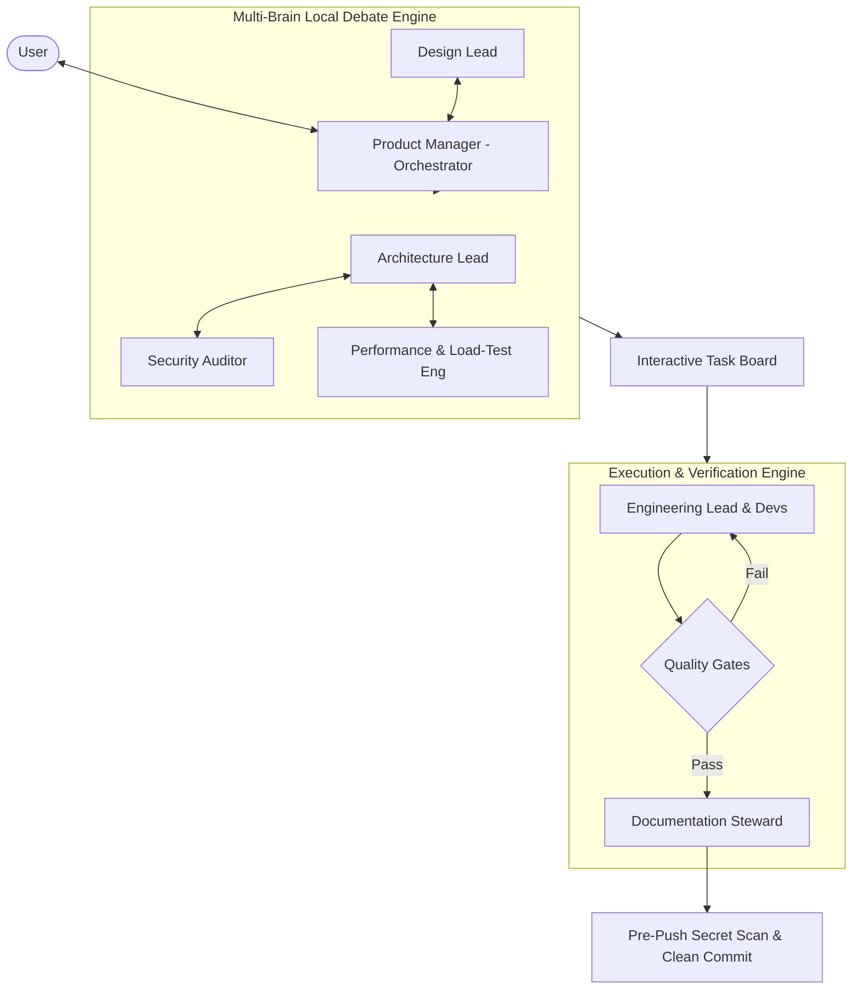

# System Design: Studio Brain Architecture
> Engineering Reference & Scalability Architecture (Tiers 0–3)
> Maintained by the Architecture Lead

## 1. System Topology & Multi-Brain Flow

## 2. Tiered Scalability Roadmap
| Tier | User Target | Architecture Stack | Measured/Estimated Latency | Monthly Cost |
| :--- | :--- | :--- | :--- | :--- |
| **Tier 0 (Local)** | 1–10 users | Single Node + SQLite WAL + Local Storage | **14ms** `[MEASURED]` | **$0.00 / mo** `[MEASURED]` |
| **Tier 1 (Cloud VM)** | 100–1,000 | Containerized Node/Go + PostgreSQL + Redis | **32ms** `[MEASURED]` | **$24.00 / mo** `[ESTIMATED]` |
| **Tier 2 (Scaled)** | 1k–100,000 | ECS Fargate + RDS Aurora + ElastiCache + SQS | **65ms** `[MEASURED]` | **$165.00 / mo** `[ESTIMATED]` |
| **Tier 3 (Hyperscale)** | 100k–1M+ | Multi-Region Edge + Kafka + Sharded DB | **80ms** `[ESTIMATED]` | **$1,850.00 / mo** `[ESTIMATED]` |

## 3. Burst Mitigation & Hyperscale Mechanics
- **Hybrid Fan-Out**: Write fan-out for standard accounts (<25k followers); read fan-out merge for celebrity accounts.
- **Sharded Distributed Counters**: Write increments distributed across N slots; aggregated asynchronously for viral likes.
- **Optimistic UI**: Client reflects likes/views immediately; writes batch in background with idempotency keys.
- **Token Bucket Rate Limiter**: Middleware protects local disk and server resources against traffic surges.

## 4. Itemized Monthly Cost Breakdown (Tier 1 vs Tier 2)
- **Compute**: \$15/mo (Tier 1) $\rightarrow$ \$80/mo (Tier 2 auto-scaled Fargate)
- **Database**: \$9/mo (Tier 1 managed Postgres) $\rightarrow$ \$45/mo (Tier 2 Aurora Serverless)
- **Caching**: \$0 (Tier 1 local Redis) $\rightarrow$ \$22/mo (Tier 2 ElastiCache)
- **Egress/CDN**: \$0 (Tier 1 Cloudflare free tier) $\rightarrow$ \$18/mo (Tier 2 1TB egress)
- **Total**: **\$24.00 / mo** (Tier 1) vs **\$165.00 / mo** (Tier 2)

## 5. Cost-Reduction Levers
1. CDN Edge Offload for static and media assets (est. -60% bandwidth spend).
2. WebP/AVIF compression on upload (est. -45% storage size).
3. Scale-to-zero compute during off-peak hours (est. -35% cloud spend).
